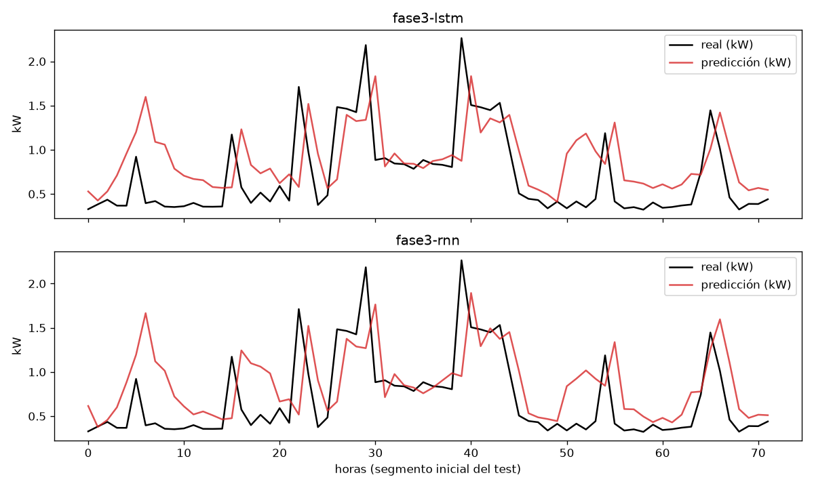

# Comparativa RNN vs LSTM (Etapa 5)

_Config: configs/train.yaml · window 24h → t+1 · hidden 64 · seed 42_

Métricas de selección: val (elección del mejor modelo). Test es la
medición final sin sesgo. Todas en kW reales.

| Modelo | MAE val (kW) | RMSE val (kW) | MAPE val (%) | WAPE val (%) | sMAPE val (%) | MAE test (kW) | RMSE test (kW) | MAPE test (%) | WAPE test (%) | sMAPE test (%) |
| --- | --- | --- | --- | --- | --- | --- | --- | --- | --- | --- |
| fase3-lstm | 0.402 | 0.569 | 46.39 | 31.94 | 35.43 | 0.355 | 0.491 | 53.68 | 37.24 | 39.44 |
| fase3-rnn | 0.405 | 0.572 | 46.15 | 32.15 | 35.51 | 0.351 | 0.495 | 51.31 | 36.78 | 38.32 |

## Nota sobre MAPE

El MAPE test (~51-54%) se ve alto para un modelo con MAE ~0.35 kW
frente a consumo medio ~1.1 kW. La causa es la definición del MAPE
con series horarias de consumo bajo: en madrugada el target puede
ser 0.03-0.1 kW y predicciones razonables de 0.15-0.3 kW generan
errores porcentuales de cientos por ciento sobre bases minúsculas.
Es un artefacto del denominador, no del error absoluto.

Para la lectura volumétrica se reporta **WAPE** (Σ|err|/Σ|y|),
que pondera por consumo real del periodo, y **sMAPE** (acotada en
[0, 200%]). El error típico por hora es ~0.35 kW, consistente con
el WAPE test reportado en la tabla.

## Curvas de predicción (test, 72 h)

_Registro en Model Registry omitido (--no-registry)._
