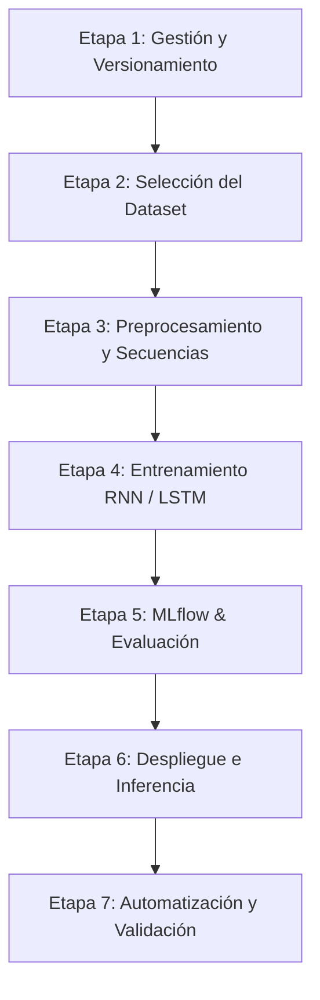
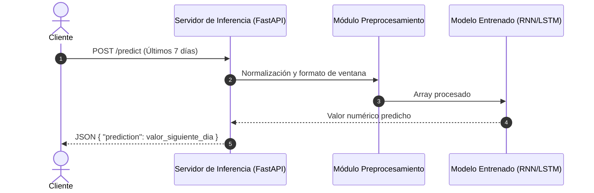
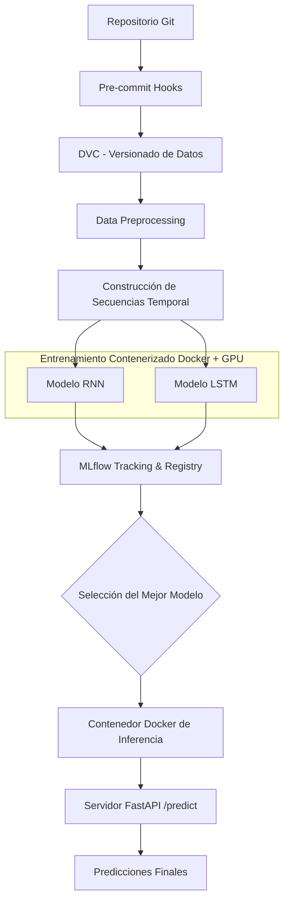

# Propuesta de Proyecto: Sistema de Forecasting de Series Temporales y Pipeline MLOps

## Resumen Ejecutivo

El presente proyecto plantea el desarrollo de un sistema de predicción (*forecasting*) de series temporales mediante redes neuronales recurrentes (**Deep Learning**). El objetivo trasciende el simple entrenamiento de modelos: se busca construir un **pipeline completo de Machine Learning (MLOps)** que abarque desde la gestión, versionamiento y preprocesamiento de datos, hasta la gestión de experimentos y el despliegue del modelo seleccionado en un servidor de inferencia.

La idea central consiste en predecir valores futuros de una variable a partir de sus observaciones históricas utilizando dos arquitecturas de redes neuronales: **RNN** y **LSTM**. Posteriormente, ambas se compararán mediante **MLflow** para seleccionar la de mejor rendimiento y desplegarla en producción.

---

## 1. Objetivo General del Proyecto

Desarrollar un pipeline de Deep Learning para la predicción de series temporales (*Time Series Forecasting*), utilizando redes neuronales recurrentes (RNN y LSTM), incorporando herramientas de versionamiento de datos, seguimiento de experimentos, entrenamiento contenerizado, pruebas automatizadas y despliegue de modelos para inferencia.

---

## 2. Etapas del Proyecto

El proyecto se estructura en **siete etapas principales**:

### Etapa 1. Gestión del Proyecto y Versionamiento
El desarrollo se mantendrá dentro de un repositorio Git con control de versiones para el código fuente y la estructura general.

*   **Git:** Control de versiones del código.
*   **DVC (Data Version Control):** Versionamiento y seguimiento de datasets y artefactos pesados.
*   **Pre-commit:** Ejecución de verificaciones automáticas antes de confirmar un commit.

*Objetivo:* Mantener un proyecto reproducible, organizado y con validaciones que prevengan errores antes de integrar cambios al repositorio principal.

### Etapa 2. Selección y Preparación del Dataset
Se seleccionará un dataset libre que contenga información temporal. Ejemplos posibles:

*   Temperatura ambiental.
*   Consumo eléctrico.
*   Precios de acciones.
*   Tráfico vehicular.
*   Ventas históricas o demanda de productos.

> **Aclaración importante:** El dataset debe contener información temporal o permitir construir una serie de tiempo. No es el modelo de Deep Learning el que genera las series temporales, sino el que aprende sus patrones.

### Etapa 3. Preprocesamiento y Construcción de Secuencias
Antes de alimentar los datos a las redes neuronales, se aplicará un flujo de transformación:

1. Limpieza de datos.
2. Tratamiento de valores faltantes.
3. Normalización o estandarización.
4. Ordenamiento cronológico.
5. División temporal en conjuntos de entrenamiento, validación y prueba.
6. Construcción de ventanas temporales (*Sliding Windows*).

#### Ejemplo de Ventana Temporal (Sliding Window)
Si se desea predecir la temperatura del día siguiente ($t+1$) utilizando los últimos 7 días:

| Entrada ($X$) | Salida ($y$) |
| :--- | :--- |
| $[\text{Día } 1, \text{Día } 2, \dots, \text{Día } 7]$ | $\text{Día } 8$ |
| $[\text{Día } 2, \text{Día } 3, \dots, \text{Día } 8]$ | $\text{Día } 9$ |
| $[\text{Día } 3, \text{Día } 4, \dots, \text{Día } 9]$ | $\text{Día } 10$ |

> **Prevención de Data Leakage:** La división debe respetar estrictamente el orden temporal y los parámetros de escalamiento (normalización) deben calcularse **únicamente** con el conjunto de entrenamiento.

### Etapa 4. Entrenamiento de las Redes Neuronales
Se implementarán e iterarán dos arquitecturas de Deep Learning:

*   **RNN (Recurrent Neural Network):** Red neuronal recurrente convencional que procesa secuencias utilizando la información del estado previo para realizar predicciones.
*   **LSTM (Long Short-Term Memory):** Variante diseñada para capturar dependencias a largo plazo y mitigar el problema del desvanecimiento del gradiente (*vanishing gradient*).

Ambos modelos procesarán los mismos conjuntos de datos bajo condiciones de evaluación equivalentes. El entrenamiento se ejecutará dentro de contenedores **Docker**, con soporte para aceleración por **GPU** (mediante entornos de NVIDIA) para optimizar los tiempos de ejecución.

### Etapa 5. Seguimiento de Experimentos y Gestión con MLflow
MLflow se integrará activamente durante todo el ciclo de desarrollo para:

*   Registrar hiperparámetros de entrenamiento.
*   Almacenar métricas obtenidas durante las épocas de entrenamiento y validación.
*   Registrar los experimentos comparativos entre RNN y LSTM.
*   Guardar y versionar los artefactos de los modelos entrenados.
*   Visualizar la observabilidad del entrenamiento y permitir la reproducibilidad.

#### Métricas de Evaluación
Para la comparación de los modelos de regresión se utilizarán:

| Métrica | Nombre | Descripción |
| :--- | :--- | :--- |
| **MAE** | Error Absoluto Medio | Promedio del valor absoluto de los errores de predicción. |
| **MSE** | Error Cuadrático Medio | Promedio de los errores al cuadrado; penaliza desviaciones grandes. |
| **RMSE** | Raíz del Error Cuadrático Medio | Raíz cuadrada del MSE; expresado en las mismas unidades de la variable. |
| **MAPE** | Error Porcentual Absoluto Medio | Porcentaje de desviación promedio con respecto al valor real. |

La selección del mejor modelo se hará evaluando el rendimiento sobre el conjunto de **validación**, reservando el conjunto de **prueba** únicamente para la evaluación final sin sesgos.

### Etapa 6. Despliegue del Mejor Modelo en Servidor de Inferencia
El modelo seleccionado se empaquetará para ser consumido por clientes externos sin necesidad de reentrenamiento.

Se propone utilizar **FastAPI** para exponer un endpoint HTTP REST independiente (ej. `POST /predict`) capaz de procesar las peticiones de inferencia.

### Etapa 7. Automatización y Validación del Proyecto
Para garantizar la integridad del código y la infraestructura:

*   Ejecución de Hooks de **Pre-commit** antes de registrar cambios en Git.
*   Orquestación mediante **Docker Compose** para desplegar de forma coordinada el entorno de entrenamiento, la interfaz de MLflow y el servidor de inferencia.

---

## 3. Propuesta sobre las "Tres Pruebas" (Testing)

Ante la especificación del requerimiento "*Testing (3 pruebas)*", se propone interpretar y desarrollar tres niveles de validación funcional e integración:

| # | Prueba | ¿Qué verifica? | Ejemplo de Validación |
| :-: | :--- | :--- | :--- |
| **1** | **Prueba de Datos y Preprocesamiento** | Correcta limpieza, ausencia de `NaN` y formato de ventanas. | Comprobar que las matrices $X$ e $y$ tengan las dimensiones (*shape*) esperadas $(N, \text{window\_size}, \text{features})$. |
| **2** | **Prueba de Modelos** | Correcto flujo *forward pass*, entrenamiento y cálculo de métricas. | Verificar que los modelos procesen tensores de entrada sin errores y devuelvan métricas válidas. |
| **3** | **Prueba de Inferencia** | Operatividad del servidor API y respuesta en tiempo real. | Enviar un payload JSON de prueba al endpoint `/predict` y validar código de respuesta `200 OK` con la estructura esperada. |

> *Nota:* Otra interpretación técnica alternativa sería evaluar el forecasting a distintos horizontes temporales (predicción a 1, 3 y 7 pasos hacia el futuro). Se sugiere confirmar con el evaluador.

---

## 4. Arquitectura General del Sistema

El flujo completo de datos, control de versiones y despliegue se resume en el siguiente esquema:

---

## 5. Tecnologías Involucradas

| Tecnología | Rol y Uso en el Proyecto |
| :--- | :--- |
| **Git / GitHub** | Repositorio de código y control de versiones. |
| **Pre-commit** | Automatización de linter, formateadores y validaciones previas a commits. |
| **DVC** | Control de versiones de los datasets y trazabilidad de datos. |
| **Python** | Lenguaje base para el desarrollo de todo el pipeline. |
| **PyTorch / TensorFlow** | Framework de Deep Learning para implementar las redes RNN y LSTM. |
| **Docker** | Contenerización de los entornos de entrenamiento e inferencia. |
| **Docker Compose** | Orquestación de contenedores y servicios (Servidor API, MLflow, etc.). |
| **MLflow** | Seguimiento de experimentos, registro de métricas y versionamiento de modelos. |
| **FastAPI** | Framework para la creación del servidor HTTP de inferencia. |

---

## 6. Entregables Esperados

1. **Repositorio GitHub:** Código fuente documentado y estructurado.
2. **Dataset Versionado:** Datos originales y procesados trazables vía DVC.
3. **Pipeline de Preprocesamiento:** Módulos para la generación de ventanas temporales.
4. **Modelos Entrenados:** Implementación modular de arquitecturas RNN y LSTM.
5. **Experimentos MLflow:** Logs detallados de ejecuciones, parámetros y curvas de entrenamiento.
6. **Reporte Comparativo:** Justificación cuantitativa de la elección del modelo final.
7. **Artefacto de Modelo Final:** Modelo empaquetado listo para producción.
8. **Servidor de Inferencia:** API REST operacional (FastAPI).
9. **Suite de Pruebas:** Las 3 pruebas automáticas/funcionales implementadas.
10. **Infraestructura como Código:** Archivos `Dockerfile` y `docker-compose.yml`.
11. **Configuración Pre-commit:** Hooks para la calidad del código.

---

## 7. Conclusión y Valor Técnico

El propósito central de este proyecto **no se limita a predecir una variable cuantitativa**, sino a demostrar la capacidad de diseñar e implementar un **sistema de Machine Learning reproducible, robusto y escalable** bajo prácticas **MLOps**.

Al finalizar, se habrá demostrado la capacidad para integrar gestión de datos, modelado avanzado en Deep Learning, observabilidad de experimentos, contenerización y despliegue continuo de inferencias en un entorno unificado.
